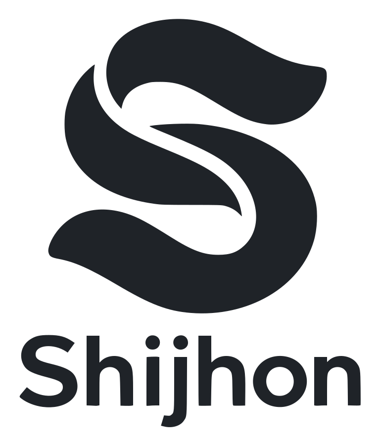
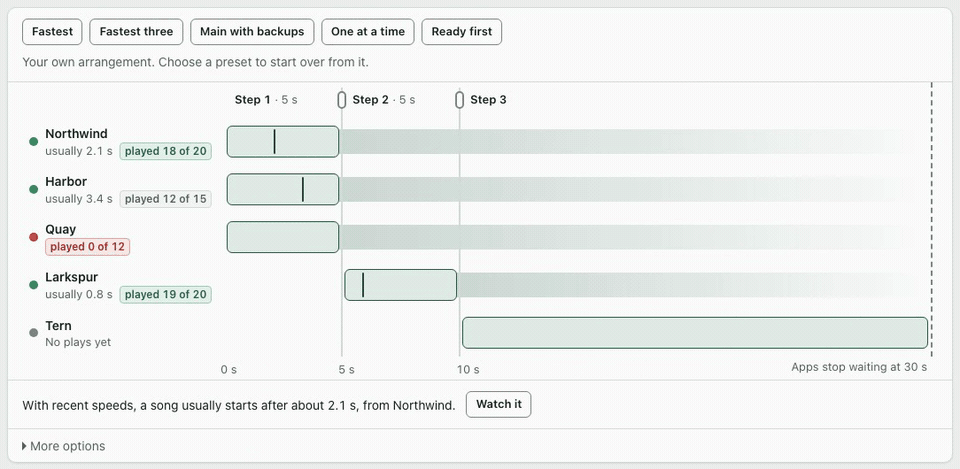

<h1 align="center">
  <picture>
    <source media="(prefers-color-scheme: dark)" srcset="docs/images/shijhon-logo-dark.svg">
    
  </picture>
</h1>

<p align="center">
  <strong>Music beyond the library, on demand, in Subsonic apps.</strong>
</p>

<p align="center">
  <a href="https://github.com/Jasshl/shijhon/releases/latest"></a>
  <a href="LICENSE"></a>
  <a href="https://github.com/Jasshl/shijhon/actions/workflows/ci.yml"></a>
</p>

<p align="center">
  <a href="docs/quick-start.md">Quick start</a> ·
  <a href="#documentation">Documentation</a> ·
  <a href="CHANGELOG.md">Changelog</a>
</p>

Shijhon lets Subsonic apps find and play music from outside the library. Searches and
artist pages show a catalog's releases beside the library's own albums, albums owned only
in part appear complete, and pressing play on any of those songs streams it on demand. A
song that someone plays, favorites or adds to a playlist brings its album into their
library.

Shijhon runs in front of an unmodified [Navidrome](https://www.navidrome.org/) server, and
apps connect to it as they would to any Subsonic server. The catalog and the audio come
from add-ons. Shijhon ships with no add-ons and no music, so what appears and plays depends
on the add-ons you use.

```text
Subsonic apps ──► Shijhon ──► Navidrome ──► music library
                     └──────► add-ons ──► catalog and audio
```

## Add-ons

Add-ons are small web services that supply a catalog, audio or both, and each is added by
its address on the dashboard. Several can supply audio side by side, and one with a catalog
of its own can be chosen as the catalog ([add-ons](docs/add-ons.md),
[catalogs](docs/catalogs.md)). They use existing add-on protocols rather than a new one
([credit](#license-and-credit)).

The dashboard's plan arranges the add-ons in timed steps, with presets for common setups,
and the first audio to arrive plays ([the plan](docs/add-ons.md#the-plan)).

<p>
  <picture><source media="(prefers-color-scheme: dark)" srcset="docs/images/dashboard-plan-dark.gif"></picture>
</p>

## Install

With Docker, you need Docker with Compose, and a music folder in which Shijhon may create
a folder of its own, `_shijhon`. Then:

```sh
git clone https://github.com/Jasshl/shijhon && cd shijhon
./setup.sh
```

The script asks where your music is and for a username and a password for your own
account, starts Navidrome and Shijhon, and prints the address apps connect to. On
Windows, run it inside WSL (untested). Then add add-ons on the dashboard and choose one of
them as the catalog ([quick start](docs/quick-start.md#what-to-add-next)). Until an add-on
is set up, apps show the library as Navidrome would.

Already running Navidrome? The script can put Shijhon in front of it instead, and your
Navidrome keeps its accounts, playlists and favorites
([in front of a Navidrome you already run](docs/deployment.md#in-front-of-a-navidrome-you-already-run)).

On NixOS, the flake's service sets up Navidrome, Shijhon and the accounts. You give it
your music folder and your own account. An existing Navidrome keeps its accounts and
favorites ([NixOS](docs/nixos.md)).

In each app, add Shijhon's address as a **Subsonic** (or OpenSubsonic) server, not a
Navidrome one. An app's Navidrome option uses Navidrome's own API for some or all of
what it shows, and that API shows the library without the catalog.

## More

- AI agents connected over MCP can make and refresh playlists and add catalog albums to
  the library ([agent access](docs/agent-access.md)). Server AI for described playlists
  is optional ([playlists](docs/playlists.md)).
- Each account chooses what its apps show: everything it collected, its own imports and
  favorites, what Shijhon added for it, or a custom library
  ([your collection](docs/collection.md)).
- Playlists can be imported from pasted lines or a file, and music files can be uploaded
  through the dashboard
  ([import a playlist](docs/playlist-imports.md), [import music files](docs/music-imports.md)).

## Documentation

- [Quick start](docs/quick-start.md): the setup, connecting your apps, what to add next,
  and the same steps by hand.
- [How it works](docs/how-it-works.md): placeholders, saved audio, matching, radio and the
  cleanup.
- [Add-ons](docs/add-ons.md) and [catalogs](docs/catalogs.md).
- [Your collection](docs/collection.md): what apps show, and custom libraries.
- [Agent access](docs/agent-access.md): AI agents over MCP, and what they can do.
- [Playlists](docs/playlists.md): discovery mixes, described playlists and preparing a
  playlist's audio. [Import a playlist](docs/playlist-imports.md): playlists from pasted
  lines or a file.
- [Import music files](docs/music-imports.md): uploading files, reviewing and approving
  them.
- [Configuration](docs/configuration.md): the settings, the command line, the dashboard.
- [Sound analysis](docs/sound-analysis.md): optional AudioMuse-AI facts for playlists.
- [Deployment](docs/deployment.md): an existing Navidrome, reverse proxies, backups,
  upgrades. [NixOS](docs/nixos.md) covers the NixOS service.
- [Privacy and security](docs/privacy-and-security.md) and
  [known issues](docs/known-issues.md).
- Reference: [how it works in detail](docs/reference/how-it-works.md),
  [playlists in detail](docs/reference/playlists.md),
  [the other settings](docs/reference/settings.md),
  [the add-on protocol](docs/reference/add-on-protocol.md),
  [advanced deployment](docs/reference/advanced-deployment.md),
  [library visibility](docs/reference/library-visibility.md),
  [personal access](docs/reference/personal-access.md),
  [agent tools](docs/reference/agent-tools.md),
  [local AI runners](docs/reference/local-ai-runners.md),
  [known gaps](docs/reference/known-gaps.md).
- [Development](docs/development.md) and [CONTRIBUTING.md](CONTRIBUTING.md).

## Status

Shijhon is in beta (0.10.0), tested with Navidrome 0.64.2. The configuration and the
database can change between beta versions. At startup the database migrates itself, and
first saves a snapshot of itself when it can ([upgrades](docs/deployment.md#upgrades)).
What changed is in [CHANGELOG.md](CHANGELOG.md).

AI writes most of Shijhon's code, tests and documentation.

## License and credit

Shijhon is free software: Copyright (C) 2026 Jasshl, under the **GNU Affero General Public
License, version 3 or (at your option) any later version** ([LICENSE](LICENSE)). In short:
you may use, study, change and share it; if you share a changed version, or run one for
other people over a network, you must offer them its source under the same license. There
is no warranty.

One additional term applies, as section 7(b) of the license allows: a modified version
must keep the author attribution and the source notice shown in the dashboard's footer.
[NOTICE](NOTICE) has its wording, the licenses of what Shijhon depends on, and what
someone who publishes a built image has to include with it.

The license covers Shijhon only. It places no requirement on add-ons, which are separate
programs. An independent catalog adapter, one that contains no code copied from Shijhon,
may be under any license, open or not. [NOTICE](NOTICE) contains that permission, which
covers only Shijhon's own code: the third-party components Shijhon runs with keep their
own licenses.

Credit: Shijhon is built on [Navidrome](https://www.navidrome.org/), which it runs
unmodified and whose behavior it matches, and on the
[OpenSubsonic](https://opensubsonic.netlify.app/) API. For add-ons it uses existing
protocols instead of a new one: the one [Eclipse Music](https://eclipsemusic.app/docs)
uses, and [BitChord](https://bitchord.kushagrasingh.in/docs)'s close variant of it.
Shijhon is an independent project, not affiliated with or endorsed by Eclipse Music or
BitChord.
