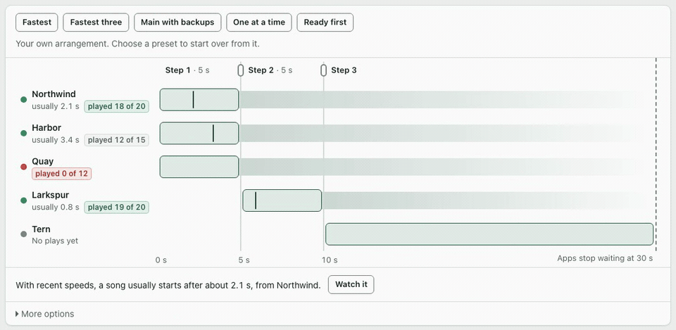

# Add-ons

Add-ons are small web services that supply the music outside the library. An add-on can
supply audio, a catalog (a search, albums and artists), or both. An add-on's catalog can
be the one apps show ([catalogs](catalogs.md#the-catalog-of-an-add-on)). Shijhon
includes no add-ons, so what shows and plays depends on the ones you add. Several can be
used together, and [the plan](#the-plan) sets how they are asked. Shijhon uses existing
add-on protocols instead of a new one: the one [Eclipse Music](https://eclipsemusic.app/docs) uses, and [BitChord](https://bitchord.kushagrasingh.in/docs)'s
close variant of it. Shijhon is an independent project, not affiliated with or endorsed by
Eclipse Music or BitChord.

## Adding an add-on

On the dashboard's **Add-ons** page, you add an add-on by its URL. There you can also
reorder, enable, disable or remove it, and fill in the settings its manifest declares. An
enabled add-on with a catalog of its own is also searched by [playlist
imports](playlist-imports.md#add-on-catalogs).

The separate [Shijhon Mornye extension bridge](https://github.com/Jasshl/shijhon-mornye-bridge)
makes Mornye extensions usable as add-ons for audio, catalog data or both. It is not
affiliated with Mornye; follow its setup guide to obtain the add-on links.

To change the order, drag an add-on by its number or use its arrows. **All on** and
**All off** switch the whole list.

To rename an add-on, change its **Name** under **Settings** and save. Only the name you
see changes. The add-on keeps its catalog, its songs and its place, and if it is the
add-on chosen on the Catalog page, that choice follows the new name. Names are unique. If
an environment variable names this add-on as the catalog's add-on, the rename is refused;
change the variable first.

Add-ons whose manifest declares no `stream` resource provide a catalog only. They are
listed apart, under **Catalog only**, and have no place in the order. Their **Settings**
leave out what only matters for audio. Their **Time for catalog answers** (`budget_seconds`
in the file) is how long playlist imports wait for a slow add-on's catalog. An add-on
whose manifest can't be read stays in the main list and shows the problem.

Add-ons can also be listed in the configuration file, in the order you want:

```toml
[[addons]]
name = "My add-on"
base_url = "https://addon.example.invalid/your-configuration"
reach = "public"
settings = {}           # the add-on's own settings, if it has any: single values
# budget_seconds = 45   # its time for a download (and, for playlist imports, for a catalog answer), e.g. for a slow one
# downloads = 2         # whole-song transfers at once; omitted: inherit
# preparations = 1      # new preparations at once; omitted: inherit
# capacity_group = "shared-worker" # same label for add-ons sharing an account or worker
```

- `base_url` is the add-on's manifest URL, with or without `/manifest.json`; a query in it
  is kept and sent with every request.
- A list in the file is applied at every start, until you change the add-ons on the
  dashboard ([which list applies](reference/settings.md#the-add-on-list-the-files-or-the-dashboards)).
- `reach` says where the add-on, its redirects and its audio links may lead:

| `reach` | Addresses |
|---|---|
| `"public"`, the default | Public addresses only |
| `"loopback"` | Also Shijhon's own machine. In a container that is the container itself |
| `"private"` | Also Shijhon's own machine and your network. In a container, an add-on on the Docker host or in another container needs this |

## The plan

<picture>
  <source media="(prefers-color-scheme: dark)" srcset="images/dashboard-plan-dark.gif">
  
</picture>

The add-ons are asked for a song in steps, shown as a timeline on the dashboard's Add-ons
page. Add-ons in the same step start together when someone plays a song, and the first to
send audio plays. Each step has a time. When that time passes without audio, the next
step's add-ons join, and the add-ons already asked keep trying. When every add-on in the
step has failed or lacks the song, the next step joins at once. Once one add-on's audio
plays, the others are stopped. Apps stop waiting after `[delivery] max_wait_seconds`.
Steps that would begin later are never reached, and the page lists their add-ons under the
timeline. The last step has no time of its own: its add-ons try until apps stop waiting.

To move an add-on into another step, pull its bar sideways into that step's column. To
give it a step of its own, pull it onto the line between two columns. To change a step's
time, pull the step's edge. After its step, each bar continues faded up to the apps'
limit, since the add-on keeps trying until then. An add-on in the list under the timeline
can be pulled up into a column, or up and down within that list. The presets arrange them
for you: Fastest (all in one step), Fastest three (the three quickest right now, then the
rest one at a time), Main with backups (the first alone, then the rest together), One at a
time, and Ready first. The page shows each add-on's recent speed. For the latest song
starts, Diagnostics lists every add-on asked, when each later step joined, what each
add-on answered and how long it took.

An add-on that times out twice in a row is passed over for 30 seconds. One that said it
doesn't have a song is not asked for that song again for a day. When another add-on's
audio comes first, an add-on still trying counts a timeout only if it was slow by its own
standard: past its step's time and past twice its usual time to first audio. When apps
stop waiting with no audio at all, every add-on still trying counts a timeout. An add-on
that is often a little late but works can get a higher **Slow after** of its own in its
settings. The [detailed rules](reference/add-on-protocol.md#the-plan-in-detail) cover
what counts as a timeout and the timings in Shijhon's log.

While the app stays connected, Shijhon goes on receiving a playing song to its end and
keeps what it received. Seeks, and playing on after a pause, are then served at once,
without asking the add-on again. With **Keep streamed songs** on, a song received in full
goes into your library.

The steps are for songs played on demand. Other requests ask one add-on at a time. When an
app loads a song ahead of time, only the plan's first add-on is asked. Preparing the next
songs in the queue, and downloads, go through the add-ons in the plan's order. Each add-on
then gets its **Time for a download** (`budget_seconds`, else `[delivery] budget_seconds`)
instead of its step's time.

With **Ask which add-ons have the song ready** on, Shijhon asks the add-ons that can tell
when a song starts. An add-on that says it has the song ready joins once the song has
gone without audio for the time you set; with 0, it goes first. One that says it doesn't
have the song ready goes last.

In the file, an add-on's `step_seconds` is its step's time, `with_previous = true` puts it
in the step of the add-on before it, `budget_seconds` is its time for a download and
`slow_after` its own "slow after":

```toml
[[addons]]
name = "First add-on"
base_url = "https://first.example/manifest.json"
step_seconds = 5

[[addons]]
name = "Second add-on"
base_url = "https://second.example/manifest.json"
with_previous = true       # starts together with the first
```

## Limits

Shijhon sends each add-on at most 5 API requests a second, after a burst of 10, and opens
at most 4 audio requests to it at once. These limits count all users and Shijhon's own
background work together. Each user can look up 4 songs and fetch 4 whole songs at a time.
Over a limit, a request waits its turn, and the song being played goes first. An add-on
you run yourself can have higher API limits of its own (`requests_per_second`,
`request_burst`, `audio_openings`). Several add-ons served at one address have separate
limits, told apart by the `id` in each one's manifest. The same add-on added twice shares
its limits. The add-on protocol reference lists [every
limit](reference/add-on-protocol.md#limits).

### Downloads and playlist preparation

An app's `download` request fetches each missing song whole into the server library, and
the dashboard's **Downloads** page does the same for a chosen native playlist. These are
files on the server; the app still saves its own copies on the device. Showing catalog
tracks downloads nothing, and neither does adding them to the library as
[placeholders](how-it-works.md#placeholders). Downloading a whole playlist as one archive
does not prepare it, so prepare the playlist first when some of its songs are still
placeholders.

The defaults on **Playback → Downloads and playlist preparation** are 4 songs fetched
at once for everyone together, and 2 per add-on. Under **Advanced settings**, new
preparation is limited to 1 song per add-on and whole-song fetches to 4 per user. All of
these limits are adjustable, and 0 removes a cap. The hourly quota is optional and
defaults to 0 (off).

Each add-on's own limits are under **Add-ons → Settings → Advanced settings**. A blank
**Songs fetched at once** or **New preparations at once** inherits the default, a number
overrides it, and 0 removes that add-on's cap. When add-ons use the same account or
worker, at one address or at different ones, give them the same **Shared account or worker
group** label. The group's strictest nonzero limit then applies to them together. The same
add-on added twice always shares these limits, while add-ons served at one address share
them only when you group them.

The add-on protocol does not report an account's remaining credits or quota, so set limits
that suit the account behind the add-on. Shijhon also honors HTTP 429 and `Retry-After`.

Playlist preparation also works with slow add-ons. Its songs wait for a free slot, and the
download timeout (180 seconds) counts only from the moment a song gets one. When every
add-on that could provide a song is paused (rate limited, cooling down after errors, or
needing its operator to sign in again), the song waits up to an hour for the pause to end
instead of failing. A song fails when no enabled add-on permits downloads or has it.
**Cancel** also stops waiting songs. An app's `download` request does not wait like this:
it fails at once when its add-ons are paused. The [detailed
rules](reference/add-on-protocol.md#downloads-and-playlist-preparation) cover the waiting
and cached copies.

## DASH links

An add-on's audio link can be a file or a DASH stream. HLS links do not play.

By default a DASH link plays from its first segments, served as one MP4 file. With
`[delivery] dash_start = "complete"`, it plays once its segments are joined into a FLAC,
M4A or MP3 file. Songs saved to the library are always such files. ffmpeg does the
joining, and the Docker image includes it. When a stream is unsupported, or its audio
length differs from the song's ([`length_tolerance_seconds`,
`length_tolerance_percent`](reference/settings.md#delivery)), the next add-on is asked
([details](reference/add-on-protocol.md#dash-links)).

## `allowDownloads`

When an add-on's manifest has `"allowDownloads": 0` (or `false`, or `"0"`), Shijhon fetches
no whole songs from it: downloads, conversions, share links and the jukebox use your other
add-ons. Plays, and preparing the next songs in the queue, still use it.

## When an add-on fails

- **It does not have the song** (HTTP 404): the next add-on is asked.
- **"Too many requests"** (HTTP 429): Shijhon asks it nothing new until its `Retry-After`
  time has passed, an hour at most. When it names no time, the pause is 30 seconds. Songs
  already playing keep playing, and other add-ons at its address are asked as before.
- **"Not ready yet"** (HTTP 503 with `Retry-After`, while it prepares the song): Shijhon
  asks for the song's link again after that time. It keeps asking as long as the add-on's
  time for the song lasts: in a play, until apps stop waiting, and in a download, for its
  time for a download. This is not an error, and a retry of the song asks this add-on
  again. An add-on that prepares whole files before sending
  them needs a head start. Give it a time for a download that covers a usual preparation,
  and put it in an early step of the plan.
- **"Needs sign-in"** (an add-on that says its operator must sign in again): the Add-ons
  page and Diagnostics show "Needs sign-in", with a link to the add-on's own sign-in page
  when it names one. This is not an error. Plays and downloads pass it over for 10
  minutes at a time and then ask it again, and playlist preparations wait for it. "Needs
  sign-in" stays until the add-on delivers audio again, or for a catalog-only add-on,
  until its catalog answers again. Once you've signed in, choose **Check again** beside it
  to have it asked again at once. Saving its settings does the same.
- **Three errors in a row** (HTTP 5xx, no connection, a broken answer), no more than ten
  minutes apart: it is passed over for 30 seconds. Until it delivers audio again, each
  further error passes it over again.

## For add-on authors

An add-on for audio needs `/stream/{id}` and one way to find a song: by ISRC
(`/resolve-isrc`), by title, artist and length (`/resolve`), or a search (`/search?q=`).

An add-on with a catalog lists the resources `search` and `catalog` in its manifest and
answers `/search`, `/album/{id}` and `/artist/{id}`
([the catalog endpoints](reference/add-on-protocol.md#the-catalog-endpoints)). One whose
manifest lists no `stream` serves only its catalog: Shijhon asks it for no audio, and the
Add-ons page lists it under **Catalog only**. A catalog-only add-on can serve as the
catalog beside audio add-ons that only find songs.

Shijhon's optional extensions let an add-on do more, and other apps that use add-ons can ignore them:

- The [full-catalog extension](reference/add-on-protocol.md#the-full-catalog-extension)
  adds disc and track numbers, release kinds, clean and explicit versions, song and ISRC
  lookups, paged discographies and a declared catalog identity, so that partly owned
  albums can be matched by their disc and track numbers.
- The [availability extension](reference/add-on-protocol.md#the-availability-extension)
  says which songs an add-on has ready, for **Ask which add-ons have the song ready**.
- The [cached delivery extension](reference/add-on-protocol.md#the-cached-delivery-extension)
  names the exact cached file of a recording, for downloads and playlist preparation.
- An add-on can say that its operator needs to sign in again
  ([answers and errors](reference/add-on-protocol.md#answers-and-errors)). It can also
  answer "not ready yet" while it prepares a song ([above](#when-an-add-on-fails)).

[The add-on protocol](reference/add-on-protocol.md) has the rest.
