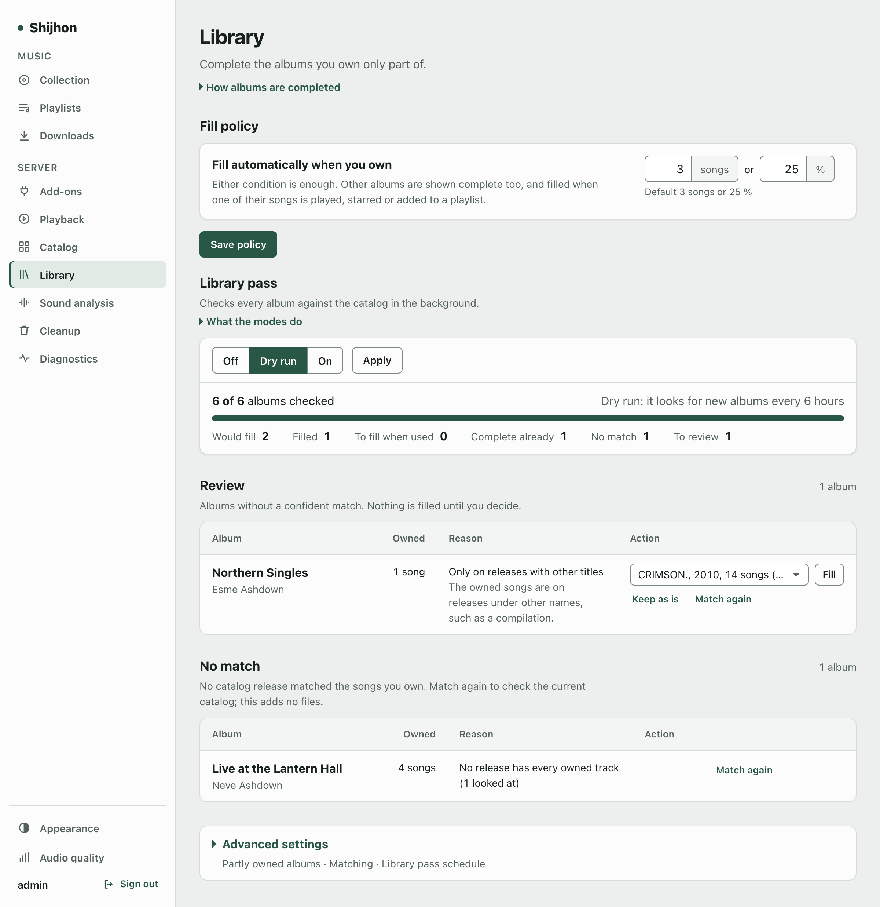

# Configuration

Shijhon reads one TOML file (`--config`; `/config/shijhon.toml` in the image). Start from
[`packaging/shijhon.example.toml`](../packaging/shijhon.example.toml).

## Which value applies

Lowest first:

1. the built-in default;
2. the configuration file;
3. a value saved on the dashboard (the `[delivery]`, `[catalog]`, `[fill]`, `[cleanup]`
   and `[audiomuse]` settings, `[search] budget_seconds`, and the add-ons);
4. an environment variable. The dashboard shows such a setting locked, with the variable's
   name.

Environment variables are named `SHIJHON_<SECTION>__<KEY>`, for example
`SHIJHON_NAVIDROME__URL`; top-level keys have no section (`SHIJHON_STATE_DIR`). A list is
JSON (`SHIJHON_SERVER__TRUSTED_PROXIES='["127.0.0.0/8"]'`), and so is the add-on list
(`SHIJHON_ADDONS`). With Compose, they go under the `shijhon` service's `environment:`;
the variables in `.env` only fill in the Compose file. A value outside a setting's limits
is refused at startup, with a message that names the setting.

## Settings saved on the dashboard

- They are kept in Shijhon's database, secrets included. Saving the value the file or the
  default gives removes the saved one, so a later change to the file applies again.
- Most take effect immediately. The pages mark the ones that apply after a restart, and
  offer **Restart Shijhon** while one waits.
- `shijhon saved --clear <section>[.<key>]` removes them; after a restart the file's values
  or the defaults apply again ([more](reference/settings.md#settings-saved-on-the-dashboard)).

## The settings

The ones most people change, with defaults in brackets.
[The settings reference](reference/settings.md) has all the others.

For OAuth/MCP agent access, set `[agents] public_url` to the public HTTPS origin
without a path and restart. Empty disables the interface. See [agent setup](agent-access.md)
for reverse-proxy routes, permissions and features that work without AI.

### Navidrome and the library

| Setting | What it sets |
|---|---|
| `[navidrome] url` | Navidrome's address, as Shijhon reaches it |
| `[navidrome] user`, `password` or `password_file` | The service account: a Navidrome admin account used only by Shijhon |
| `[navidrome] library_id` (1), `library_path` | The library that holds your music, and where Shijhon sees it on disk |
| `[navidrome] artist_participations` (`false`) | Match Navidrome's `Subsonic.ArtistParticipations` setting for artist album counts in personal library views. Set both to `true` if artists should include albums on which they perform as a track artist. Artist indexes still list album artists, as Navidrome does |
| `[navidrome] usage_export_path` | The usage export, which the cleanup reads ([deployment.md](deployment.md#the-usage-export)) |
| `[server] trusted_proxies` (loopback) | The reverse proxies whose `X-Forwarded-For` is trusted ([deployment.md](deployment.md#network-and-reverse-proxy)) |

`[[addons]]` is in [add-ons.md](add-ons.md#adding-an-add-on).

### `[music_imports]`

File uploads are off by default. Set `enabled = true` only after provisioning a
dedicated writable `folder` (`"_imports"`) inside the configured native library.
Navidrome must see the same files. Keep this folder separate from `_shijhon`,
include all its files in backups, and complete the administrator's reviewed
**Collection → Import music → Finish personal library setup** step before uploading.
Existing files stay in place; setup records which account imported them and
preserves other existing users' selections. See [music imports](music-imports.md)
for formats, quotas, transfer limits and recovery.

The import limits are in bytes, seconds or counts: `max_file_bytes`, `max_job_bytes`,
`max_job_files`, `max_owner_jobs`, `max_owner_bytes`, `max_global_bytes`,
`min_free_bytes`, `max_uploads`, `upload_seconds` and `validation_seconds`.
These settings are configured in TOML or the environment and take effect on restart.
Disabling uploads does not reset ownership or existing collection choices.

### `[delivery]`

On the dashboard's Playback page; `keep_streamed_audio`, `delivered_days` and `delivered_gb`
on its Cleanup page.

| Setting | What it sets |
|---|---|
| `routing` (`ordered`), `primary_source`, `reliable_source` | How an add-on is picked for a song ([add-ons.md](add-ons.md#routing)); the two names are add-ons' names |
| `budget_seconds` (9) | The time allowed until audio starts, including one fallback. With `primary_first` the primary may use all of it, and the fallbacks get a budget of their own. An add-on can have its own |
| `max_wait_seconds` (30) | The longest an app waits for the first audio, all tries together. At least `budget_seconds`; keep it below the apps' own timeouts |
| `keep_streamed_audio` (false) | A song whose whole audio Shijhon received while an app streamed it replaces its silent placeholder, as downloaded audio does ([how it works](how-it-works.md#placeholders)). Nothing more is fetched to finish a song: one skipped before Shijhon had all of it is not kept. Applies at once |
| `delivered_days` (30), `delivered_gb` (10) | After this many days unused, downloaded or kept audio is replaced by its silent placeholder again. Once all of it together is larger than this size, the least recently used is replaced first. 0: no age limit, or no size limit; with both 0 it is kept for good |
| `quality_default` (`"192"`) | The lowest quality listeners hear from a file unless they chose their own on their Audio quality page ([below](#audio-quality)): `"128"`, `"160"`, `"192"`, `"256"` or `"320"` - compressed audio (MP3, AAC, Opus...) needs at least that many kbit/s, lossless audio (FLAC, ALAC...) is accepted at any bitrate, and both need 44.1 kHz - or `"lossless"` (lossless audio only, 44.1 kHz or more) or `"any"` (no check). Applies at once |
| `dash_quality_from` (`"any"`), `dash_quality_to` (`"lossless"`) | Of the qualities a DASH manifest offers, the highest in this range: `"128"`, `"192"`, `"256"`, `"320"` (kbit/s) or `"lossless"`; the lower end may also be `"any"`, and may not be above the upper |

The limits per add-on and per user are in [add-ons.md](add-ons.md#limits).

#### Audio quality

Each person chooses the lowest quality they want to hear on their **Audio quality** page
(beside Appearance): any quality; compressed audio (MP3, AAC, Opus...) of at least 128,
160, 192, 256 or 320 kbit/s, with lossless audio (FLAC, ALAC...) at any bitrate; or
lossless audio only. Every choice but "any" also asks for 44.1 kHz. Without a choice of
their own, `quality_default` applies. For that listener:

- A song whose file is below it - an owned or imported file, or a catalog song's
  downloaded audio - plays from the add-ons under its own ID when they have the recording
  (found as any catalog song is: its ISRC, else its title, artist and length). An add-on
  whose audio tells a quality below the minimum too (an MP3's bitrate, say) is passed
  over for the next one, in the add-ons' usual order and time; when none has it well
  enough, the file plays. A file that meets the minimum plays as it is, with nothing
  asked. While no one has a minimum (`quality_default` is "any" and no one chose
  another), a song with its own file is Navidrome's as before, without even a credential
  check - unless a play of it from the add-ons that began earlier is under way; otherwise
  its stream checks the listener's credentials once. A play from the add-ons keeps their
  audio for its later ranges, also when the file changes meanwhile (an upgrade) or the
  minimum does, to none too; the next play from the start follows the minimum as it is
  then.
- Through the OpenSubsonic transcoding extension, Navidrome decides from the file as
  always. When the app asks for the song as it is, with no bitrate limit, and Navidrome
  answers with direct play, the stream is the add-ons' audio, in a format the app plays
  as it is by its profile (FLAC for an app that plays only MP3 is passed over). A decision
  with a bitrate limit, or one that converts, plays the file. A later range of such a
  stream keeps the add-ons' audio with the decision it began with (also after an upgrade,
  and whatever decisions the app asks for afterwards: they decide its next plays) or with
  another one Navidrome accepts for the same app profile; any other token is Navidrome's
  to answer.
- A file below it does not play for a catalog song (a placeholder an owned recording
  plays for, or a catalog song not in the library yet): the add-ons do, and the file only
  when they have nothing. A download or conversion of such a catalog song puts the
  add-ons' audio in the library instead of a copy of that file.
- Accounts that get real audio only (`[placeholders] real_audio_accounts`) always get the
  files.
- Share links and the jukebox play the file: a share link is opened by someone without an
  account, so no one's minimum applies, and the jukebox plays on the server's own speakers
  straight from the library's files.

The quality of a file is Navidrome's (its format, bitrate, sample rate and bit depth); a
file whose quality Navidrome does not know is never passed over. The add-ons' audio is
taken as good enough unless its first bytes tell otherwise (an M4A's bitrate is not read).

The same page has **Upgrade my imported songs from the add-ons** (on unless the person
switches it off): after they play one of their own imported songs that went to the
add-ons this way, the add-ons' audio becomes that song's file when it meets their minimum
and is better than the file - fetched as the play was, passing over audio below their
minimum ([music-imports.md](music-imports.md#upgrading-your-imported-songs)).
It never changes another person's imports or the music folder. Their lowest quality also
decides whether an imported file goes into a catalog song it matched
([music-imports.md](music-imports.md#your-audio-for-catalog-songs)).

### `[catalog]` and `[search]`

On the dashboard's Catalog page.

| Setting | What it sets |
|---|---|
| `kind` (`none`) | The name of an installed catalog adapter ([catalogs.md](catalogs.md)), whose own settings go in this section too. `addon`: the catalog of one of your add-ons, named by `addon` |
| `twins` (`explicit`) | Which of the clean and explicit versions of an album or song are shown: `explicit`, `clean` or `both` |
| `[search] budget_seconds` (8) | The longest a search, the page of an artist in your library or an artist's top songs waits for the catalog ([catalogs.md](catalogs.md#a-catalog-that-answers-slowly)). 120 at most |

### `[fill]` and `[cleanup]`

On the dashboard's Library and Cleanup pages. [how-it-works.md](how-it-works.md) says what
filling and the cleanup do.

| Setting | What it sets |
|---|---|
| `[fill] enabled` (on) | Matching and filling of albums that are partly in your library |
| `[fill] library_pass` (`dry_run`) | The pass over the whole library: `dry_run`, `on` or `off` |
| `[fill] auto_min_songs` (3), `auto_min_share` (0.25) | The fill policy: an album is filled automatically when you have at least this many of its songs, or this share of its tracks. 1 song: every album |
| `[fill] auto_pick` (on) | When several releases fit an album, or the one that fits numbers its tracks differently from your files, the most likely is used. Off: such albums go to the review list |
| `[cleanup] mode` (`off`) | `off`; `dry_run`: the daily check logs what it would take out; `on` |
| `[cleanup] unused_days` (30) | A release nobody has used is taken out this many days after it was added |
| `[cleanup] catalog_albums` (on), `fills` (on) | Which releases: catalog albums added to the library, and the songs added to partly owned albums |

### `[audiomuse]`

On the dashboard's Sound analysis page. Optional sound analysis for described playlists
([sound-analysis.md](sound-analysis.md)); these apply after a restart. The account
AudioMuse-AI signs in with is named in
[`[placeholders] real_audio_accounts`](reference/settings.md#top-level-server-navidrome-placeholders),
which is set in the file or the environment only.

| Setting | What it sets |
|---|---|
| `url` | AudioMuse-AI's address. Empty (the default): sound analysis is off |
| `token` | Its API token, never shown or logged. It goes only to the host (scheme, host and port) it was set up with: one in the file or the environment to the file's or environment's `url`, one saved on the dashboard to the address it was entered for. When the address in use is on another host, the token is not used until it is entered again |
| `server` | The name or ID AudioMuse-AI gives this Shijhon among its media servers. Empty: its default server |
| `reach` (`public`) | Where it runs: `loopback` (this machine; in a container, the container itself), `private` (also your network and the Docker host) or `public` |
| `timeout_seconds` (20) | The longest one request to it may take |
| `sync_hours` (6) | How often Shijhon reads which songs are analyzed, and their analysis (it also does once after starting, if the last time was longer ago) |

## The command line

`--config <file>` goes before the command. In the running container:
`docker compose exec shijhon shijhon --config /config/shijhon.toml matches`.

- `shijhon serve`: runs Shijhon.
- `shijhon matches`: lists the album matches and the review list; `--all` also lists
  complete albums and those without a match. It changes nothing, and reads only Shijhon's
  database, so it also lists albums of other catalogs and regions, and ones no longer in
  the library.
- `shijhon cleanup`: lists what the cleanup would take out now, what it keeps, and why. It
  changes nothing, and needs `usage_export_path` or `database_path`.
- `shijhon saved`: the settings saved on the dashboard, secrets hidden;
  `--clear <section>[.<key>]` removes them.
- `shijhon catalogs`: the installed catalog adapters.
- `shijhon fills-undo`: lists the automatic fills the fill policy would not make now;
  `--apply` undoes those nobody used, with Shijhon stopped
  ([advanced deployment](reference/advanced-deployment.md#undoing-automatic-fills)).
- `shijhon usage-export`: writes the usage export (the Compose file runs it as a service).
- `shijhon carry-over`: shows the catalog albums carried over at the upgrade to schema 24
  and who has them; `--account <name>` gives them to that Navidrome account's Shijhon
  library, once - again for the same account changes nothing, another account needs
  `--replace` ([upgrades](deployment.md#upgrades)). It needs Navidrome (to look the account
  up) and a database this Shijhon has started on, and can run while Shijhon runs.
- `shijhon version`.

## The dashboard

At `/shijhon/` on Shijhon's address, sign in with your Navidrome account. Personal
playlists, imports, audio preparation, connections and appearance belong to your account.
Installation pages require a current Navidrome administrator and library access. The pages
work without JavaScript except the music-file transfer page, which needs it for
file selection, transfer progress and resuming uploads. The sidebar groups the pages
under **Music**, for everyone, and **Server**, for administrators; on a narrow screen it
is behind **Menu**. Each settings page shows the settings most people change first, the
rest under **Advanced settings**.

Under Music, **Collection**, **Playlists** and **Downloads** are your own music, playlists
and audio prepared for your apps. Under Server:

- **Add-ons**: add, order (by dragging), enable, disable or remove add-ons, switch them
  all on or off, and their settings.
- **Playback**: the `[delivery]` settings.
- **Catalog**: which catalog is used, and its settings.
- **Library**: the fill policy, the library pass, the **review list** (albums whose
  match needs a decision) and the albums **picked automatically**. Fill one from a release
  you choose, keep it as it is, or match it again.
- **Cleanup**: what Shijhon added, the cleanup's settings, what its last check took out
  or would take out, and the **Saved audio** settings (keeping streamed songs, and how
  long and how much saved audio is kept). A change that lets it take out
  more first shows what the next check would take out.
- **Sound analysis**: the connection to AudioMuse-AI ([guide](sound-analysis.md)).
- **Diagnostics**: Navidrome, the add-ons, the catalog, versions, recent errors, and
  **Restart Shijhon**.

**Appearance** and **Audio quality**, at the foot of the sidebar, set the dashboard's colors
and the lowest quality you hear ([Audio quality](#audio-quality)). **Playlists**
connects your own listening profile and AI preferences; [Discovery playlists](playlists.md)
covers AI connections, runtime limits and the optional `[playlists]` configuration.

<picture>
  <source media="(prefers-color-scheme: dark)" srcset="images/dashboard-library-review-dark.png">
  
</picture>

<picture>
  <source media="(prefers-color-scheme: dark)" srcset="images/dashboard-diagnostics-dark.png">
  
</picture>
