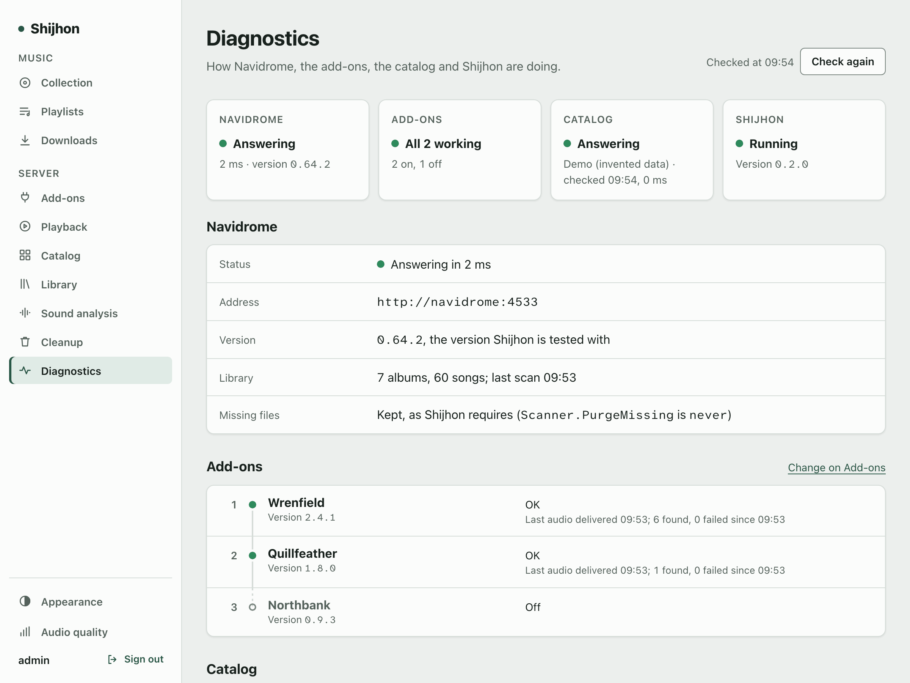

# Quick start with Docker Compose

```sh
git clone https://github.com/Jasshl/shijhon && cd shijhon
./setup.sh
```

The script runs on Linux and macOS; on Windows, run it inside WSL. It has not been
tested in WSL yet. Run it in the checkout, the `shijhon` folder that `git clone` made.

It first asks whether to set up a new Navidrome or to put Shijhon in front of one you
already run. For a new one it asks where the music is, for a username and a password for
your own account, for the port apps connect to (4533 by default, or the next free one),
and for catalog adapters to install. Leave the adapters blank: they are the legacy way to
get a catalog, and an add-on's catalog needs no adapter ([catalogs](catalogs.md)). It then
creates a folder of its own, `_shijhon`, in the music folder, sets up your account and an
admin account named `shijhon` for Shijhon's own use, and starts everything. The first
start builds the image and takes a few minutes. The answers are saved in `packaging/.env`
and `packaging/config/shijhon.toml`. If you run the script again, it continues from what
is already there. `./setup.sh --help` lists its options.

A second installation on the same machine needs a checkout of its own and a Compose
project name of its own. Run the script in that checkout as
`COMPOSE_PROJECT_NAME=name ./setup.sh`. The script saves the name in that checkout's
`packaging/.env`, so the installation gets its own volumes, network and image. Every later
Compose command in that `packaging/` folder acts on it, in any terminal.

Already running Navidrome? Answer `running`, and Shijhon goes in front of it. Navidrome
keeps its accounts, IDs, playlists and favorites
([deployment.md](deployment.md#in-front-of-a-navidrome-you-already-run)).

The [Compose file](../packaging/compose.yaml) runs Navidrome behind Shijhon, reachable
only through it, and keeps the data of both in Docker volumes ([where the data
is](deployment.md#where-the-data-is)).

At the end the script prints the addresses to connect to. You sign in to apps and the
dashboard with the account it created.

## Connecting

Connect your apps to Shijhon, never to Navidrome, at the address the script printed. With
the default port that is `http://127.0.0.1:4533` on this machine, and
`http://<this machine's address>:4533` from other devices. Add it as a
**Subsonic** (or OpenSubsonic) server, even in apps that offer a Navidrome option. That
option uses Navidrome's own API for some or all of what the app shows, and that API shows
the library without the catalog ([known issues](known-issues.md#before-you-install)).
Navidrome's web interface, where you add other people's accounts, is at `/app`. The
dashboard is at `/shijhon/`. To check the installation, play something from your library
and look at the dashboard's Diagnostics page.

<picture>
  <source media="(prefers-color-scheme: dark)" srcset="images/dashboard-diagnostics-dark.png">
  
</picture>

Music you add to the music folder later appears in apps by itself. Once Navidrome has
scanned it, this usually takes a minute or two, and at most about five minutes.
**Collection → More → Refresh music** on the dashboard shows it at once.

Apps show **All** by default: your imports and favorites, plus everything Shijhon added
from the catalog for you. You can switch to another library on the Collection page ([your
collection](collection.md)).

To upload your own music files, enable the optional
[music-import storage](deployment.md#music-imports) and open **Collection → Import music**.
Before the first import, an administrator chooses which account counts as the importer
of the music already on the server. After that setup, new accounts start empty, and each
person's uploads join their **Original imported library** and **All**. Other people can
add shared music to their own libraries without it counting as their import.

The connection is not encrypted, as with a plain Navidrome, so use it only on a network
you trust. For access from outside, put a TLS reverse proxy in front
([deployment.md](deployment.md#network-and-reverse-proxy)).

## What to add next

Music from outside the library shows and plays only through add-ons, and Shijhon ships
with none. Until one is added, apps show the library as Navidrome would.

1. On the dashboard's **Add-ons** page, add each add-on by its address and arrange which
   are tried first ([add-ons](add-ons.md)). An add-on supplies audio, a catalog, or
   both.
2. On the **Catalog** page, choose **An add-on's catalog**, save, choose an add-on that
   has a catalog, save again and press **Restart Shijhon**
   ([catalogs](catalogs.md#the-catalog-of-an-add-on)). Searches and artist pages in apps
   then include its releases. Press play on one to check that an add-on with audio
   delivers it. A catalog adapter, a separately installed package, is the
   legacy option ([catalog adapters](catalogs.md#catalog-adapters-legacy)).
3. Optionally, connect AI agents over MCP to make playlists and add albums
   ([agent access](agent-access.md)). The script asks for the agent address, which is
   Shijhon's HTTPS address. You can also enter it later on the dashboard. The
   **Playlists** page then shows the address to add in an agent app.

## By hand

These steps make the same installation by hand. Run the commands in the checkout's
`packaging/` folder (`cd shijhon/packaging`), where the Compose file is.

1. **Write `.env`**, and create `_shijhon` before the first start (otherwise Docker
   creates it owned by root). The containers run as `PUID:PGID` (1000:1000 unless set),
   and that user must be able to read the music. The music folder is mounted read-only,
   except `_shijhon`.

   ```sh
   cat > .env <<EOF
   MUSIC_DIR=/path/to/music
   PUID=$(id -u)
   PGID=$(id -g)
   EOF
   . ./.env
   mkdir -p "$MUSIC_DIR/_shijhon"
   ```

   You can also set these in `.env`:

   - `SHIJHON_PORT=4533`, the port apps connect to.
   - `SHIJHON_BIND=127.0.0.1`, to accept connections from this machine only.
   - `SHIJHON_NETWORK=172.30.99`, the first three numbers of Shijhon's Docker network.
     Set it when Docker says "Pool overlaps" because another network has that range.
   - `NAVIDROME_DATA`, `SHIJHON_DATA` and `USAGE_EXPORT_DATA`, to keep that data in a
     folder instead of a Docker volume. Don't use them with Docker Desktop.
   - `COMPOSE_PROJECT_NAME=name` for a second installation on the same machine, which then
     gets its own volumes, network and image.

2. **Copy the configuration** and keep it private: it will hold a password, add-on URLs
   and catalog access. The example needs no change.

   ```sh
   mkdir -p config
   cp shijhon.example.toml config/shijhon.toml
   chmod 600 config/shijhon.toml
   ```

3. **Start Navidrome, then create the accounts.** The first is Shijhon's service account,
   an admin account used only by Shijhon. The second is your own. Each command asks for
   that account's password. Put the service account's password in
   `config/navidrome-password`, and keep it private like the configuration. Both files
   must be readable by `PUID`.

   ```sh
   docker compose up -d navidrome
   until docker compose logs navidrome | grep -q "server is ready"; do sleep 1; done
   docker compose run --rm -it navidrome user create -u shijhon --admin
   docker compose run --rm -it navidrome user create -u yourname --admin
   (umask 077; read -rs pw && printf '%s\n' "$pw" > config/navidrome-password && unset pw)
   chmod 600 config/navidrome-password
   ```

4. **Start everything** (the first start builds the image, which takes a few minutes),
   then [connect your apps](#connecting). The second command shows Shijhon's log until you
   press Ctrl-C:

   ```sh
   docker compose up -d --build
   docker compose logs -f shijhon
   ```
